# 1. The Scale Agency Dashboard

**RNF Technologies · 2026 · my latest and biggest work, the main tool of the digital marketing division**

## The problem
The division ran on Google Sheets: one sheet for each of 16 project managers, a master sheet joining them, and more sheets for payment tracking and call reports. One small change meant editing 16 sheets, numbers did not always match, and anyone could copy a whole sheet.

## What I built
One web app for the whole division, with 35+ tabs:
- **Money:** Payments, EOM (end of month), Month on Month, Refunds/Disputes, Delayed Payments, Stats
- **Project managers:** Inventory, My Inventory, Inventory View, Retention Analysis, PM Performance, Performance Review, [PM Recommendations](02-pm-recommendations.md)
- **Sales:** New Sales, Sales Pipeline, My Sales, Sales Scoreboard, Process Analysis
- **Leads:** Lead Management, Lead Generator Performance, DT Daily Report
- **Calls:** Dialing Report (see [Video Meet](05-video-meet-reconciliation-system.md))
- **Contests:** the live TV boards (see [Contest Dashboards](03-contest-dashboards.md))
- **Admin:** User Management (access tab by tab), Application Logs (every change, by whom and when), and App Alerts and a Bin, which open as side panels

## How it grew
It began as the Payment Reconciliation tool, which brought Stripe and PayPal payments together. It then grew one tab at a time. Reports that used to be separate tools, like the DT Daily Report and the Lead Generator dashboard, moved in during October 2026. By then, every old sheet was switched off.

## How it works
- Payments from Stripe and PayPal flow into a MySQL database every 5 minutes, and deals from HubSpot every minute.
- The server works out every number with SQL, and the website shows it.
- Background jobs assign new leads and send the daily report on their own.
- In-app alerts warn when a job fails or the database is getting busy.
- When a payment is mapped, the app creates the HubSpot deal and next month's client record by itself.
- Nothing is really deleted: a deleted row goes to the Bin and can be put back.

## Some of the analysis inside
- **Retention %** is always the total money received divided by the total money expected, never an average of percentages.
- **Refunds** in the same month are capped at the payment, so a refund can't take off more than came in.
- **Sales Pipeline** is a weighted forecast: each stage has its own chance of closing.
- **Sales Scoreboard** places reps in tiers using two targets: money in the bank and conversion.
- **Process Analysis** follows leads to meetings booked, meetings held and clients won, and shows whose clients are still paying one and two months later.

## My part
I designed the data model, the metrics (for example retention %, money in the bank after refunds, PM efficiency), the business rules and the checks. Every new number was matched against the old sheets before people switched over. The code was written with an AI coding assistant from my detailed specifications, and I tested it at each step. The look is inspired by Apple's Liquid Glass, and the motion by OnePlus OxygenOS.

## Results
- About **65 people** use it every day: project managers, sales reps, lead generation and managers.
- It replaced **16 project-manager sheets and a master sheet**, and holds **32 months** of history in one place.
- Mapping a payment takes seconds; refunds and disputes match up automatically.
- In my words: work that used to take a week now takes one or two days.

## Tools
MySQL 8 · SQL · Node.js, Express and TypeScript · React · Stripe, PayPal, HubSpot and Gmail APIs · scheduled jobs · Python (for Excel and PDF reports)

## What I learned
Design the data first. Check every new number against the old system before asking people to trust it. Build alerts, so problems are found before users find them.

## Screens
Every name, email, website and amount in these pictures is made up. The layout is the real app.

### Money

**Payments**

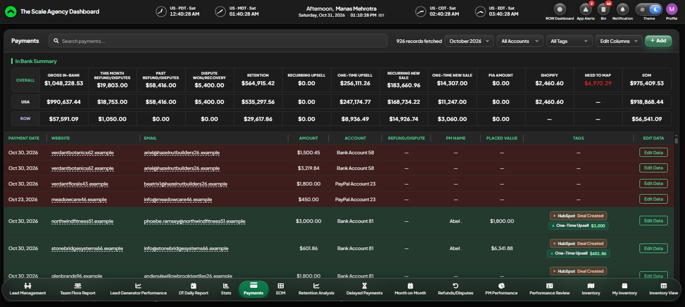

**Edit Mapping**

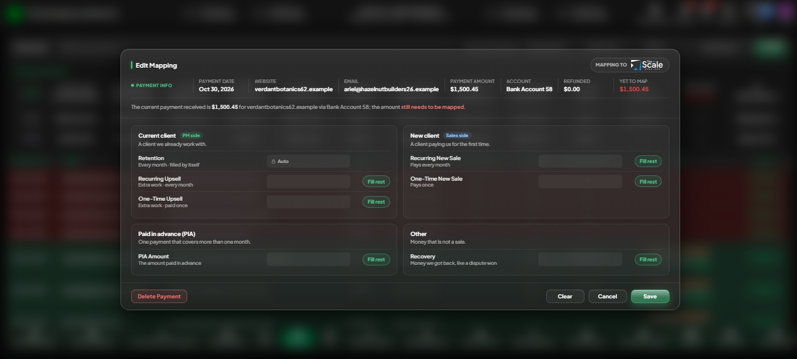

**EOM**

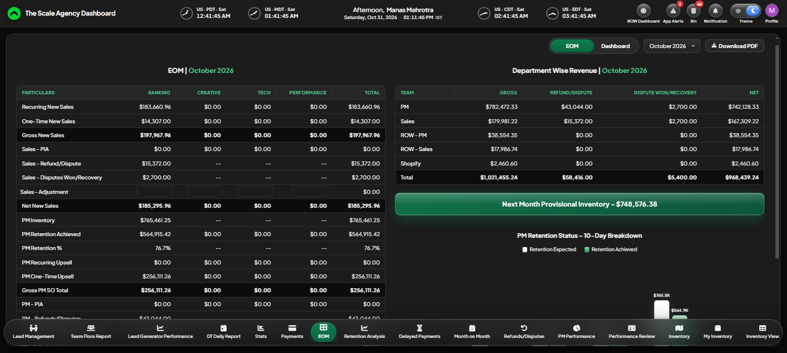

**Month on Month**

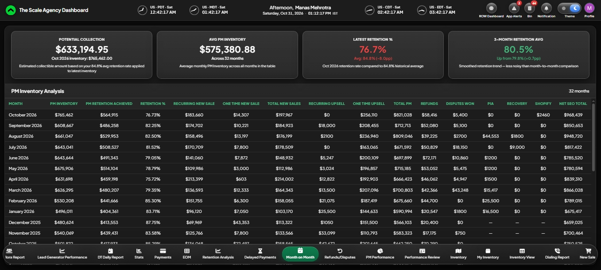

**Refunds**

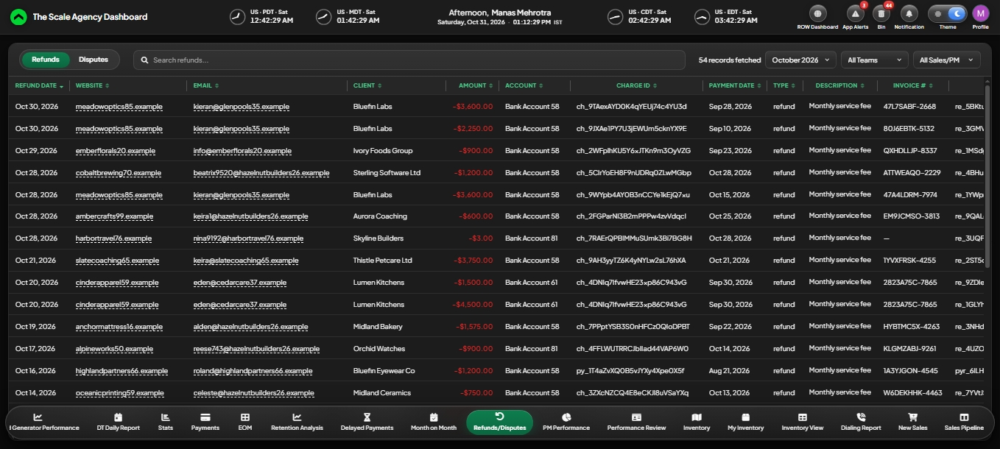

### Project managers

**Retention Analysis**

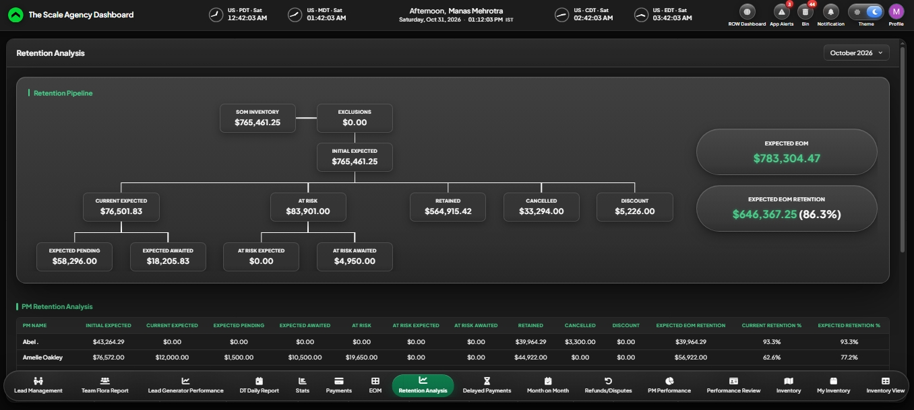

**My Inventory**

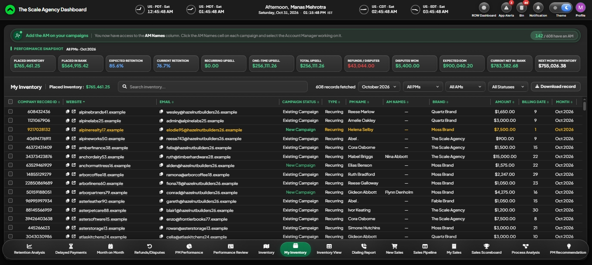

### Sales

**New Sales**

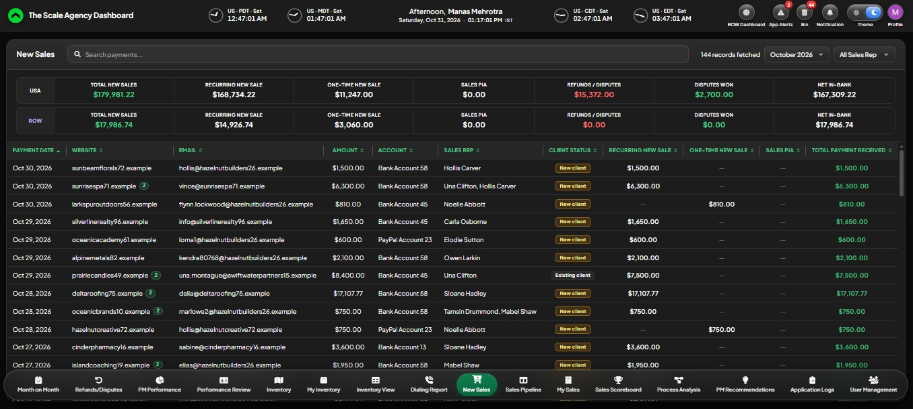

**Sales Pipeline**

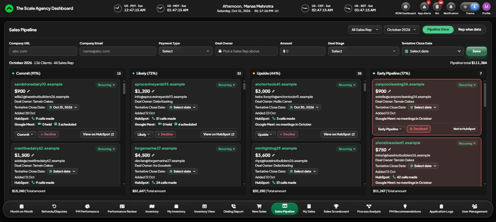

**My Sales**

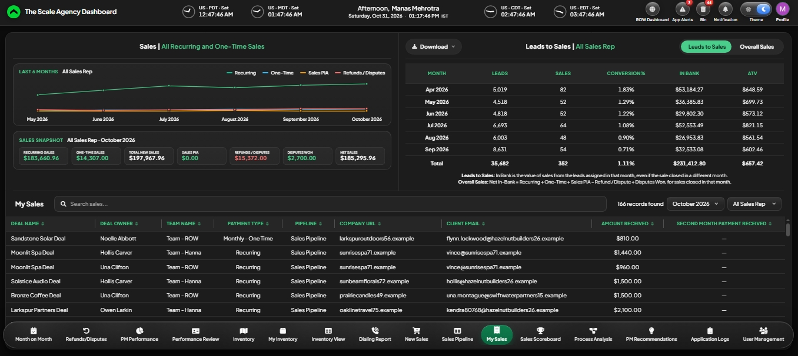

**Process Analysis**

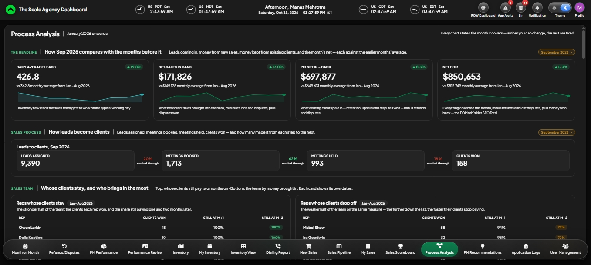

### Leads

**Lead Management**

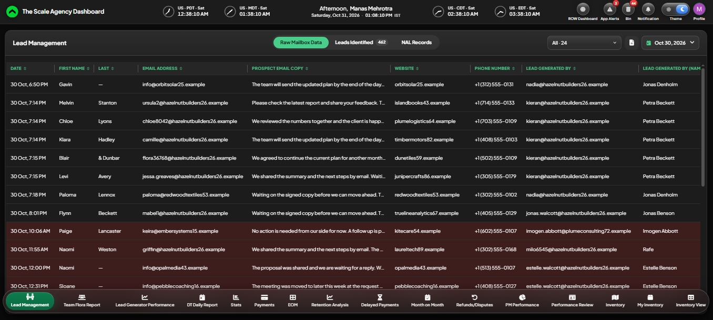

**Team Flora Report**

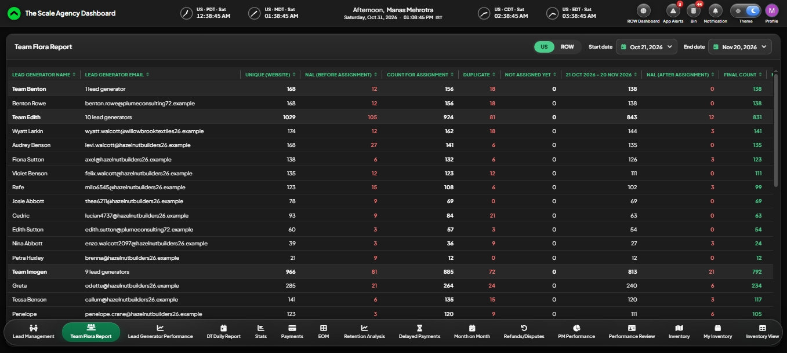

**DT Daily Report**

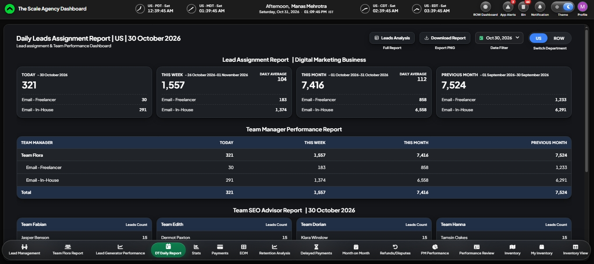

### Calls

**Dialing Report**

### Admin

**User Management**

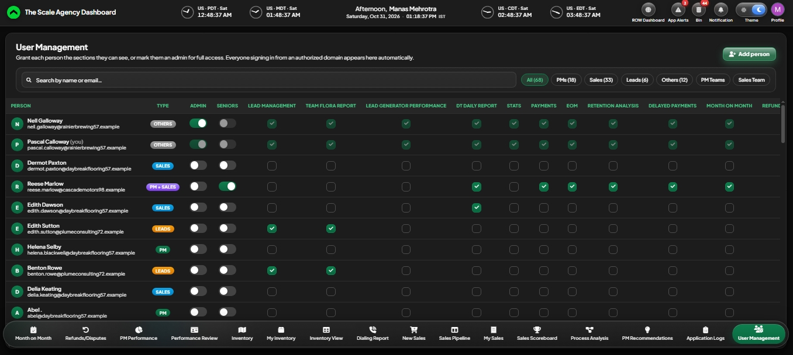

**Application Logs**

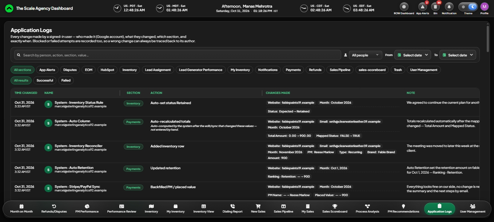

**App Alerts**

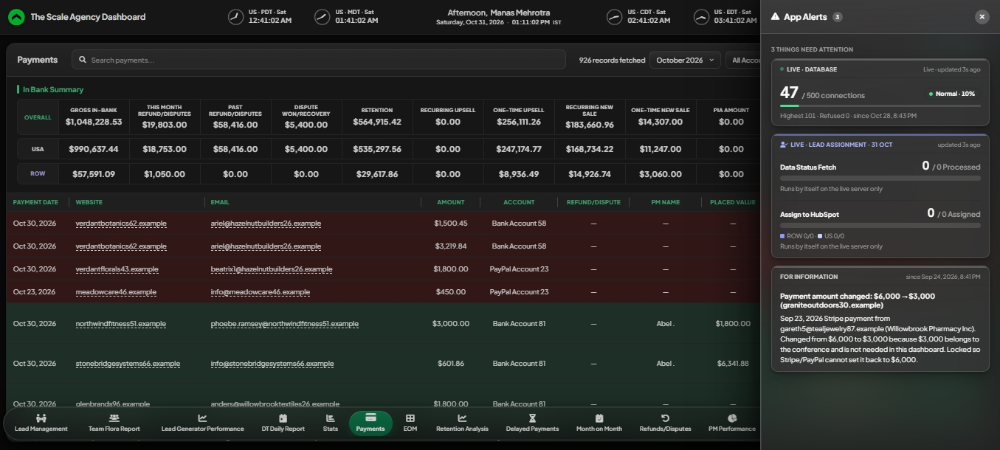

**Bin**

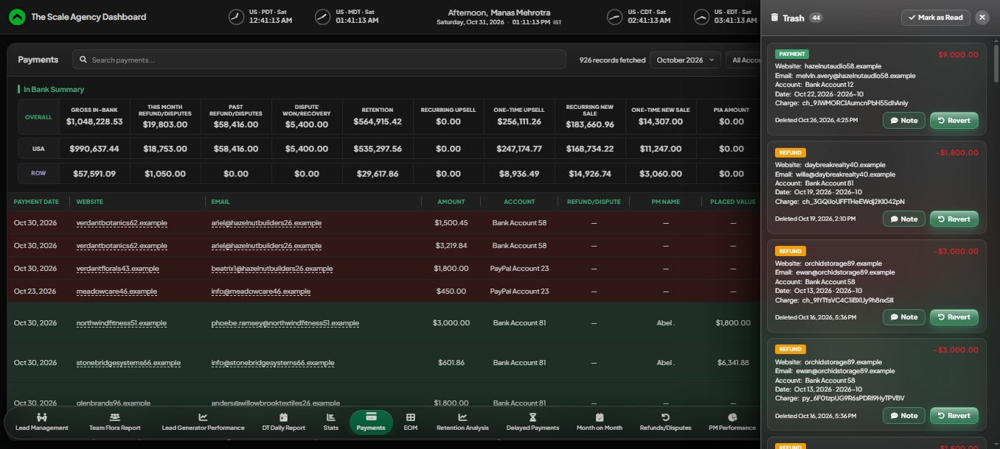

### Light theme

**Payments**

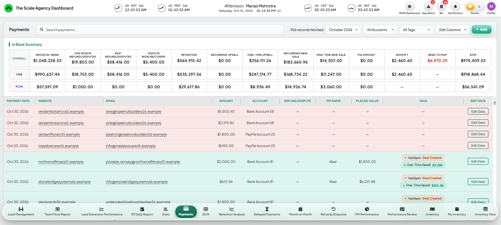
