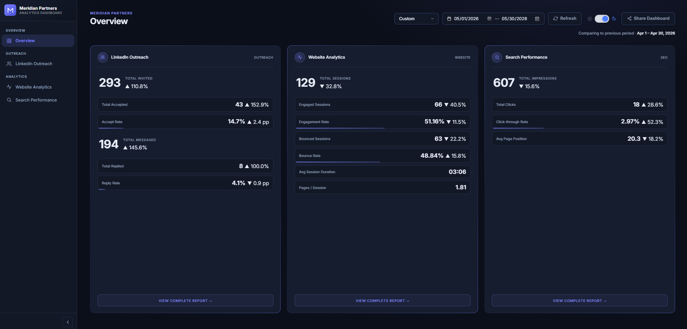
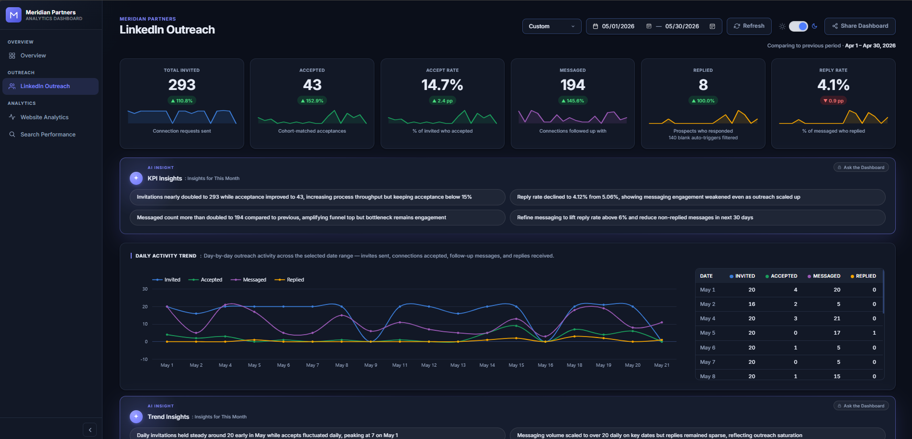
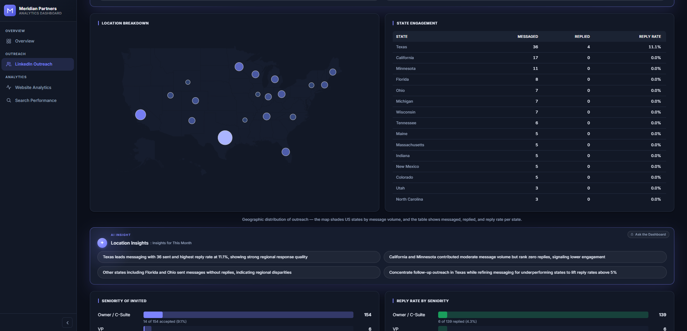
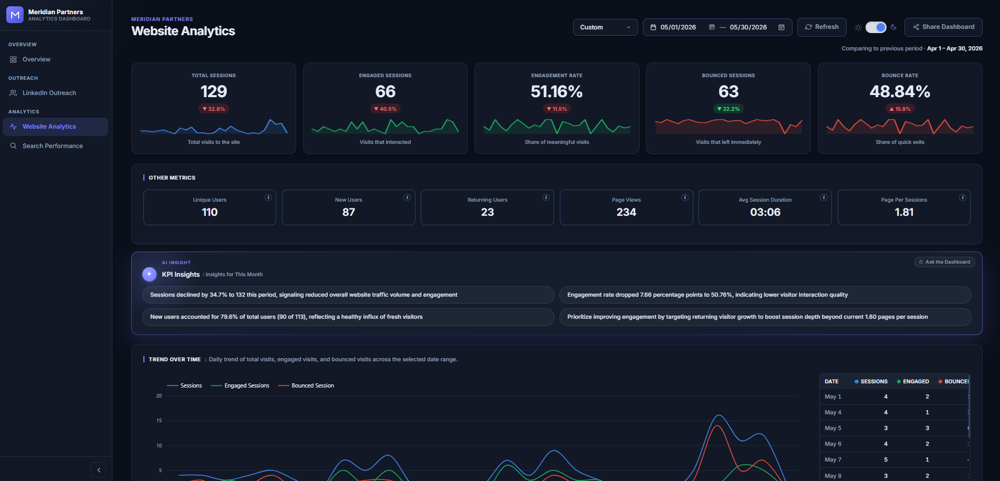
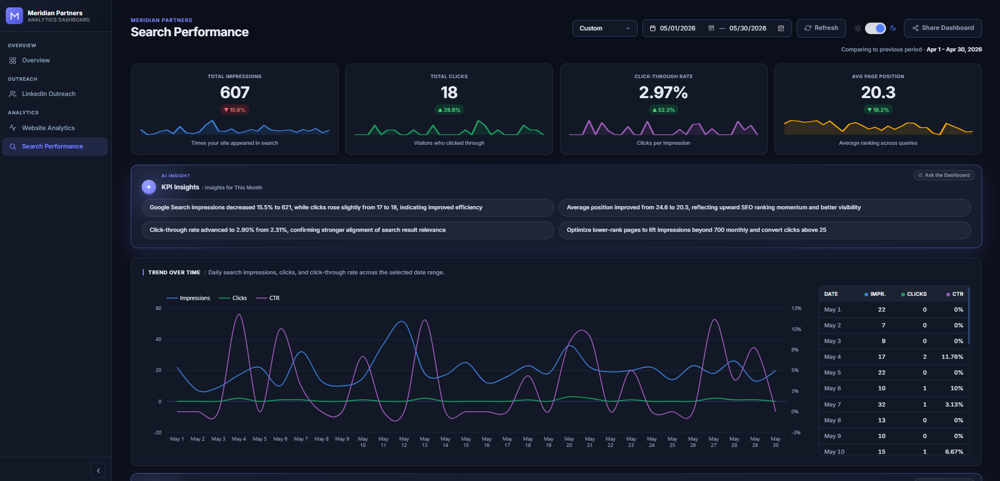

# 4. Client Analytics Dashboard ("Meridian Partners")

**RNF Technologies · 2026 · built for a client; the client's name has been changed**

## The problem
A client wanted to see its website traffic, its Google search performance and its LinkedIn outreach in one place, instead of in three separate tools.

## What I built
A web dashboard with **43 KPIs** across:
- **Google Analytics 4:** visits, users, devices, engagement and daily, weekly and monthly trends
- **Google Search Console:** clicks, impressions and search positions
- **LinkedIn outreach:** activity from the LinkedIn outreach tool

Every KPI can be compared with the previous period.

## How I got there
- GA4, Search Console and the LinkedIn outreach tool were all new to me, so I learned them quickly with help from our account-management and LinkedIn teams.
- Nobody had decided which numbers mattered, so I pulled all the raw data into a sheet and explored every column before choosing the 43 KPIs.
- We first planned it in Looker Studio, but it could not give the clean, animated look a client dashboard needed. I proposed a web app instead, and my manager agreed.

## Screens

## Tools
Google Analytics 4 · Google Search Console · Google Sheets · Google Apps Script (web app) · SQL

## What I learned
Explore the data before deciding what to show, and pick the tool that fits the audience.
