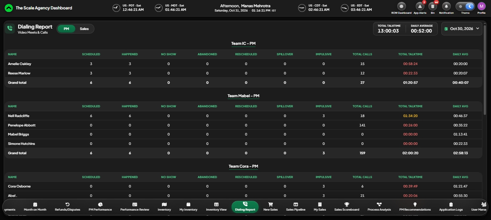

# 5. Video Meet Reconciliation System (call analytics)

**RNF Technologies · daily call and meeting numbers for sales and project managers**

## The problem
Managers wanted to see, every day, how each project manager and sales rep did on client calls: how many calls were booked, how many really happened, the no-shows, and the total talk time. I was building this report by hand every day from three sources and sharing it in a group chat.

## What I built
A Python pipeline that collects call data from:
- **Google Meet and Google Calendar** (who joined which meeting, and for how long)
- **RingCentral** (phone calls)
- **HubSpot** (calls logged in the CRM)

It saves everything in a MySQL database, works out the numbers for each person and each working day, and produces the daily reports. The report now lives inside The Scale Agency Dashboard as the "Dialing Report".

## How it works
- The team works an evening shift to match US hours, so a "day" runs from 7 PM to 7 PM India time, not midnight to midnight. Every source is lined up on that same shift day.
- For each person and day it counts: calls scheduled, calls that happened, no-shows, abandoned and rescheduled calls, total calls, total talk time and the daily average.
- Internal meetings are separated from client calls by email domain.

## Screen
The names and numbers in this picture are made up.

## My part
I defined every KPI and the rules behind them (the shift day, what counts as a no-show or an abandoned call, how to match one person across three systems), and I checked the results against the old manual report. The code was written with an AI coding assistant.

## Results
- Covers **40+ sales and project-management staff**.
- The daily report is automatic and refreshes through the day; the manual report is gone.

## Tools
Python · MySQL · Google Admin Reports and Calendar APIs · RingCentral API · HubSpot API

## What I learned
Define the working day the way the team really works. Small rules, like where a day starts, change every number downstream.
