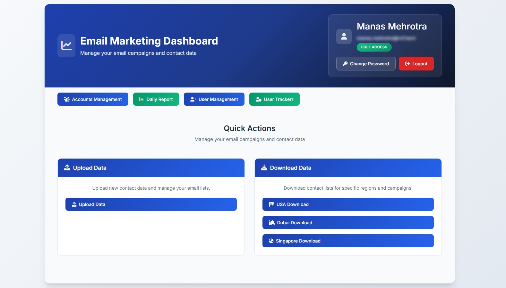
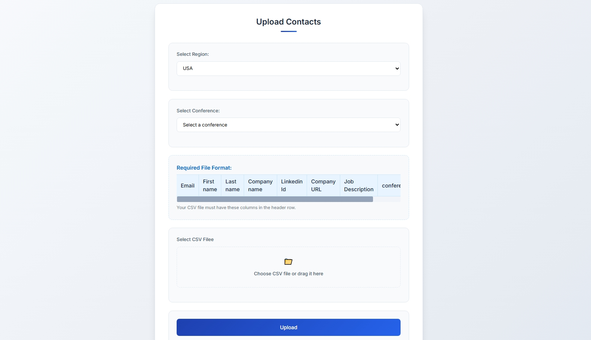
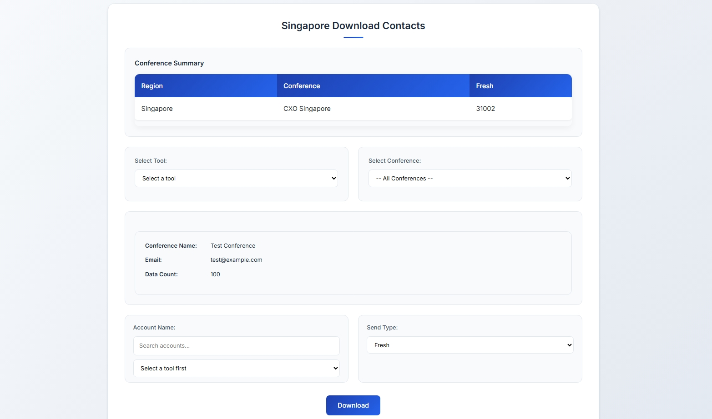

# 6. Email Marketing Dashboard

**RNF Technologies · 2025–2026**

## The problem
The email marketing team works with large contact lists for conferences in three regions (USA, Dubai and Singapore). The lists were handled by hand: duplicates slipped in, nobody could tell which contacts a sending mailbox had already used, and it was easy to send too much from one account.

## What I built
A web tool for the team:
- **Upload:** a CSV list for a conference, checked for duplicates before it is saved.
- **Download:** a batch of contacts for one sending account. Never-contacted people come first, the batch is marked as sent in one step, and each account can take at most 1,000 contacts a day.
- **Reports:** a daily report and a user tracker.
- **Unsubscribes:** a nightly job that reads the unsubscribe list and marks those contacts.
- **Audit log:** every upload, download and login is recorded.

Large lists are loaded with a Python script (pandas + MySQL, 5,000 rows at a time, adding new contacts and updating existing ones).

## Screens

## My part
I took over a half-built tool when a colleague left, worked out what the team really needed, and finished it. I designed the data rules (duplicates, fresh-first, the daily limit, the audit log). The code was written with AI coding assistance.

## Results
- Handles **200,000+ contacts** across three regions.
- Every action is logged, so "who downloaded what, and when" always has an answer.

## Tools
Node.js and Express · MySQL · SQL · Python (pandas) · Google Sheets API

## What I learned
Logging every action is what makes a data tool trustworthy for a whole team.
