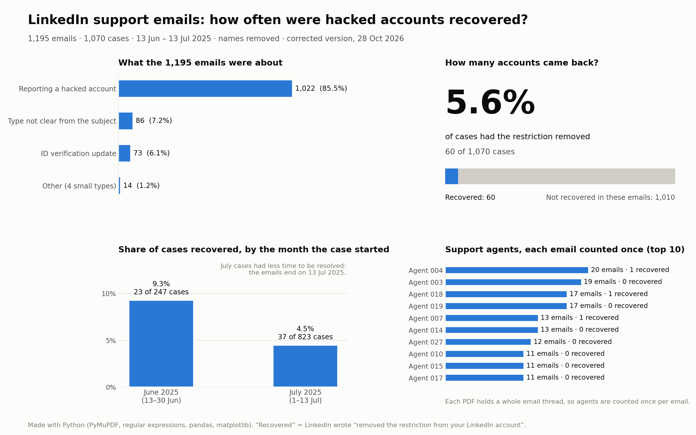

# 9. LinkedIn Support Email Analysis (Python)

**RNF Technologies · July 2025 · Python only**

## The problem
In mid-2025 the company received about 1,200 emails from LinkedIn support about restricted accounts, saved as PDF files. The questions: how does LinkedIn give a restricted account back, and how often does it happen?

## What I did
1. **PDF to text:** read every PDF with PyMuPDF.
2. **Scanned files:** used OCR (pdf2image + Tesseract) for the 15 PDFs that had no text inside.
3. **Find the facts:** used regular expressions to pull the date, case number and type from each file name, and to spot the emails where the restriction was removed.
4. **Count and show:** counted everything with Python, saved a table with pandas, and drew charts with matplotlib.

## What I found
- **1,195 emails**, which make up **1,070 separate cases**.
- The restriction was removed in **60 cases (5.6%)**.
- Most of the emails were reports of hacked accounts.

## What I would do better
Each PDF held the whole email thread, so the same support agent's signature appeared several times in one file. My first chart counted signatures instead of emails, which made some agents look far more successful than they were. Counting each agent once per email fixes it. I re-checked this in October 2026.

## Tools
Python · PyMuPDF · pdf2image + Tesseract (OCR) · regular expressions · pandas · matplotlib

## Note
The emails and their attachments contain personal details, so that data is not shared here. The charts above have no names.
